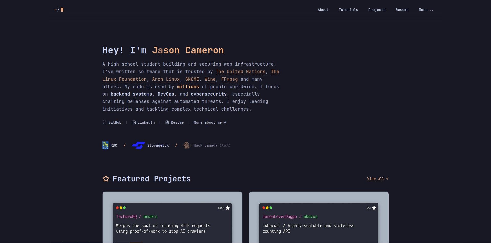

# Nyx

## Build and deploy this portfolio with Orbit

This repository contains the SvelteKit portfolio and the complete, editable Three.js Orbit game in `games/orbit/`. Both ship from **one adapter-node application**. Orbit is served at `/game/index.html`, with its destination pages under `/game/planets/`. The Game link in the portfolio opens the game as a separate document.

Use Node.js **22.14.0** (see `.nvmrc`), Bun **1.3.5** (see `packageManager`), and npm. From the repository root:

```sh
bun install --frozen-lockfile
bun run build
HOST=0.0.0.0 PORT=3000 bun run start
```

The normal `bun run build` first runs `npm ci` against `games/orbit/package-lock.json`, builds Orbit with Vite, **replaces** the generated `static/game/` assets, then builds SvelteKit. No additional repository, game process, API key, or build-time copy step is needed. `games/orbit/dist/` and `static/game/` are generated and gitignored. Source, textures, icons, the Web Worker, and third-party notices are versioned in `games/orbit/`.

For local portfolio development, run `bun run build:game` once before `bun run dev`, and again after changing Orbit source; the game is served from its generated static assets. To develop Orbit itself with Vite's hot reload, run `npm --prefix games/orbit ci` and then `npm --prefix games/orbit run dev` separately.

For deployment, configure the build command as `bun install --frozen-lockfile && bun run build`, start as `node build`, and use a Node/Bun environment with npm available. The server listens on `PORT` and optionally `HOST`; the host must support a persistent Node server (this uses `@sveltejs/adapter-node`). Keep `/game/*` static paths intact when setting reverse proxies or CDN rules. The application must be rebuilt after Orbit changes; there is no separate game deployment. See [Orbit integration notes](games/orbit/INTEGRATION.md).

Nyx is my personal digital playground and the third iteration of my portfolio, designed to showcase my projects,
experiments, and journey in the world of software development.

<a href="https://nyx.jasoncameron.dev" target="_blank">
  
</a>

<div align="center">
  <a href="https://abacus.jasoncameron.dev" target="_blank">
    
  </a>
  
  
  
</div>

## Inspirations

Nyx draws inspiration from various innovative websites and projects. To view my wild brainstorming process, check out
the <a target="_blank" href="https://notes.jasoncameron.dev/Website">Ideas Board</a>.

---

Thank you for visiting — and please leave a ⭐ if you likey!
